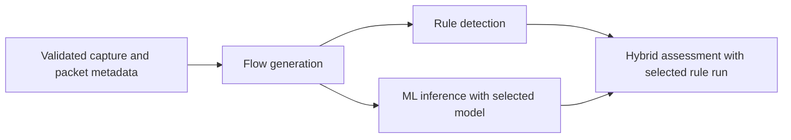

# SENTINEL Analysis Pipeline

SENTINEL's pipeline coordinates existing capture, flow, rule, anomaly, and hybrid services. It records what was requested and what happened; it does not replace their business logic. The pipeline is synchronous and offline. It does not train a model.

## Stage dependencies

The `flows` stage requires a completed analysis and consistent persisted packet metadata. Rule detection and ML inference require completed flows. Inference requires an explicit ready model ID. Hybrid assessment requires both a completed rule run and complete inference results for the selected model. When hybrid is requested without its producer stages, the request must explicitly identify the existing detection run and model; the matching inference results must already exist. The pipeline does not invent empty results from a missing stage.

The stages are executed in this fixed order: flows, detection, inference, hybrid. Only requested stages execute. Existing prerequisite outputs are validated and shown as reused. Flow generation can itself reuse a completed result. Detection, inference, and hybrid services retain their own configuration/version-specific idempotency rules.

## Run and stage states

A run has `running`, `completed`, or `failed` status. Each of its four ordered stage records has `pending`, `running`, `completed`, `skipped`, or `failed` status. `requested` distinguishes a requested operation from a prerequisite state. A stage can be completed with `reused=true` when the corresponding persisted result was already valid. Stages not selected remain skipped unless a selected downstream stage needs an existing prerequisite, in which case the prerequisite is recorded as completed and reused.

A prerequisite error marks the requested stage that could not proceed as failed, then marks later pending stages skipped. Previously committed stage results remain available. Error summaries are safe user-facing descriptions and do not contain exception traces or filesystem paths.

## Idempotency and version selection

The request identity includes the normalized stage selection, selected model ID/version, selected prior rule run when applicable, and current detection or hybrid configuration hashes for requested stages. Repeating a completed identical request returns the historical run. Failed runs remain in history; retrying starts a new pipeline run and reuses valid flow, rule, inference, and hybrid outputs according to the underlying stage services. Different models, rule runs, or scoring configurations remain distinguishable. A pipeline record refers to source run/model/assessment IDs; detailed results stay in their existing tables.

The analysis row is serialized for initial claiming, and MySQL named locks prevent two requests from orchestrating the same analysis at once across API workers. If a process ends while a run is recorded as running, the next request acquires that lock and marks the abandoned run and its unfinished stage before retrying. The lock is released automatically by MySQL when a process connection ends. SQLite test environments exercise the recovery state transition without providing cross-process locking.

## Transaction boundaries and recovery

Each completed stage is committed before the next one starts. This keeps earlier successful outputs visible if a later stage fails. Individual stage services retain their own transactions and duplicate prevention. Pipeline metadata cannot make capture storage and MySQL operations one global atomic transaction; the ingestion service remains responsible for upload cleanup and packet-processing recovery.

On a failed request, the pipeline stores a safe failure summary and leaves earlier completed results intact. A retry creates a new run record instead of rewriting the failed history. If a worker is killed mid-stage, stage work is recovered according to the durable stage record: service-level idempotency handles partially attempted outputs, and the pipeline starts a new run. Capture parsing is not rerun by the pipeline; upload processing is a separate lifecycle.

## Synchronous execution limits

The API call waits for each requested stage to finish, so request duration and API worker occupancy grow with capture size. Existing services process database data in batches, but a whole pipeline is not a background job. This implementation introduces no queue or message broker. Large captures or model operations can exceed client or server request timeouts; a durable background-worker design is future work.

Missing evidence is not a normal result. A skipped ML stage does not mean a flow was normal, and an unrun rule stage does not mean no suspicious rule pattern exists. A hybrid assessment is only produced when both selected evidence sources are present and complete.
