# SENTINEL

**Intelligent Hybrid Network Intrusion Detection System**

**Final-Year Project Report**

Submitted in partial fulfilment of the requirements for **[DEGREE / PROGRAMME]**

| Submission field | Details |
| --- | --- |
| Degree / programme | [DEGREE / PROGRAMME] |
| Student name | [STUDENT NAME] |
| Student ID | [STUDENT ID] |
| Department | [DEPARTMENT] |
| Institution | [INSTITUTION] |
| Supervisor | [SUPERVISOR NAME / TITLE] |
| Academic year | [ACADEMIC YEAR] |
| Submission date | [SUBMISSION DATE] |

This document is an implementation and evaluation report. Bracketed identity fields are submission placeholders and must be completed by the student; no personal or institutional details have been supplied to the project team.

## Declaration

I, **[STUDENT NAME]**, declare that this project report describes work completed for the SENTINEL Intelligent Hybrid Network Intrusion Detection System. The implementation, evaluation, and limitations reported here are based on the project source code and persisted evaluation record. External material is identified in the references.

Student signature: ______________________________

Date: ______________________________

## Acknowledgements

**[Replace this instruction with acknowledgements written and approved by the student. Do not submit this placeholder as completed personal text.]**

## Abstract

SENTINEL is a defensive, offline network intrusion detection application for authorized PCAP and PCAPNG analysis. It validates uploaded capture structure and size, extracts packet metadata without persisting packet payloads, aggregates bidirectional flows, applies configurable rule indicators, and provides versioned Isolation Forest inference and an evidence-preserving hybrid risk assessment. A FastAPI service persists analysis state and results in MySQL; a React and TypeScript single-page application presents analyses, traffic analytics, security events, incidents, and evaluation reports. Stage APIs remain independently accessible, while the pipeline API executes only explicitly selected eligible stages and reuses valid stored results.

The project includes a reproducible synthetic evaluation, `sentinel-synthetic-flow-v1`. Sixteen benign captures form the training partition and 27 disjoint captures form the test partition, comprising 15 benign and 12 recipe-labelled suspicious cases. On this deliberately small, synthetic set, configured rules produced 12 true positives, no false positives, 15 true negatives, and no false negatives. ML-only and hybrid capture-level decisions each produced four false positives and no false negatives. These results are specific to the generator recipes and do not establish real-world accuracy. Three repeated benchmark passes measured a median end-to-end time of 47.646 ms per test capture in the isolated benchmark environment. These measurements are not production throughput claims. Anomaly scores and hybrid scores are not probabilities of compromise. The application remains an unauthenticated local single-user tool with synchronous processing and no automatic capture-retention policy.

## Table of Contents

[[AUTO_TOC]]

## List of Figures

1. SENTINEL application architecture.
2. PCAP-to-hybrid analysis pipeline.
3. Rule detection workflow.
4. Isolation Forest training and inference.
5. Hybrid evidence scoring.
6. Analyst-led incident lifecycle.
7. Reproducible synthetic evaluation workflow.
8. Core persisted entities and relationships.
9. Overview dashboard using persisted records.
10. PCAP upload interface.
11. Completed analysis details.
12. Traffic analytics for one selected synthetic capture.
13. Persisted security event feed.
14. Incident overview using a synthetic demonstration record.
15. Evaluation run history for the synthetic dataset.

## List of Tables

1. Abbreviations.
2. Implemented system requirements.
3. Database migration history.
4. `flow-v1` numeric feature families.
5. Evaluation confusion matrices and metrics.
6. Rule category results under configured thresholds.
7. ML score threshold sweep.
8. Processing times and throughput.
9. Security and quality findings.
10. Selected API groups.

## Abbreviations

Table 1. Abbreviations.

| Abbreviation | Meaning |
| --- | --- |
| API | Application Programming Interface |
| F1 | Harmonic mean of precision and recall |
| FPR | False-positive rate |
| IDS | Intrusion Detection System |
| IPS | Intrusion Prevention System |
| ML | Machine learning |
| NIDS | Network Intrusion Detection System |
| PCAP | Packet capture file format |
| PCAPNG | Packet Capture Next Generation |
| REST | Representational State Transfer |
| SOC | Security Operations Centre |
| SQL | Structured Query Language |

## Chapter 1 — Introduction

### 1.1 Background

Network intrusion detection examines traffic for patterns that may warrant investigation. A network capture preserves packet records for offline review. Offline analysis lets an analyst repeat processing against a fixed input and inspect derived evidence without attaching an intrusion detection process directly to a production network. It also creates risks: captures can contain sensitive identifiers, malformed records, and a large amount of work relative to file size.

An IDS reports evidence and indicators. An IPS takes action to block or alter traffic. SENTINEL is an offline IDS and deliberately does not modify network traffic, firewall rules, or endpoint state. Its findings indicate observed patterns; they do not prove attacker intent or compromise.

### 1.2 Problem statement

Packet-level data is detailed but difficult to interpret as a set of conversations. Rule-based indicators can describe explicit patterns but depend on thresholds and can flag benign behavior. Unsupervised anomaly detection can identify observations that differ from its training data, yet unusual behavior is not necessarily malicious. A useful application therefore needs to preserve the origins and supporting evidence for each result, make the processing choices visible, and avoid representing scores as calibrated probabilities.

### 1.3 Motivation

The project brings capture ingestion, flow aggregation, rule detection, ML inference, hybrid scoring, and analyst investigation into one locally runnable application. The emphasis is traceability: persisted results point to their source analysis, run, model version, flow, or finding. The dashboard distinguishes analysis history from current event views, and the incident system keeps analyst investigation records separate from detection evidence.

### 1.4 Objectives

The implemented objectives are:

- Ingest PCAP and PCAPNG files with bounded, content-based validation.
- Persist packet metadata while omitting packet payloads.
- Generate deterministic bidirectional flows and numeric flow features.
- Run configurable rules for multi-port probing, SYN-heavy traffic, and distinct TCP tuples containing SYN-only traffic.
- Train versioned Isolation Forest models from explicitly selected analyses and perform inference with an explicitly selected model.
- Combine selected persisted rule and ML evidence using a documented hybrid scoring configuration.
- Orchestrate requested stages without implicitly training a model or rerunning valid results.
- Present analyses, traffic statistics, events, incidents, and evaluation results through a browser application.
- Evaluate the engines on a reproducible labelled synthetic dataset and disclose its limitations.

### 1.5 Scope and contributions

SENTINEL supports offline PCAP/PCAPNG analysis, relational persistence, a browser dashboard, analyst-created incidents, and a fixed synthetic evaluation framework. The contribution is an integrated and inspectable software prototype with stage provenance, bounded synchronous operations, deterministic synthetic data generation, and explicit score semantics.

Live capture, automated response, firewall blocking, external threat intelligence, and multi-user authentication are outside the implemented scope. They are not prerequisites for the offline workflow and are not claimed as completed features.

## Chapter 2 — Background and Related Technologies

### 2.1 PCAP, PCAPNG, and packet metadata

Classic PCAP files contain a global header followed by timestamped records. SENTINEL accepts supported PCAP 2.4 byte orders and microsecond or nanosecond timestamp variants. PCAPNG files are block-oriented; this implementation accepts version 1.0 sections and validates the block structures it supports. Structural validation is a safeguard, not a proof that every possible packet body is semantically valid. The cited PCAPNG format document remains an Internet-Draft [9].

The parser uses Scapy's `PcapReader` incrementally. For each packet it stores the packet index, available timestamp, source and destination addresses, available transport ports, network and transport protocol metadata, packet length, supported TCP flags, and ICMP type/code. Payload bytes are not stored. Missing fields remain missing rather than being filled with fabricated values.

### 2.2 Bidirectional flow analysis

A flow groups records by a canonical endpoint tuple. For TCP and UDP, that tuple contains IP version, protocol, and two address/port pairs. Protocols without transport ports use addresses and protocol identity. Endpoints are ordered deterministically; A-to-B is called forward and B-to-A backward. This convention does not infer client/server roles.

Flow records contain total and directional packet/byte counts, duration, packet-length statistics, inter-arrival statistics, available TCP flag counts, and packet/byte rates. Rates are null if duration is zero or unavailable. ICMP records do not distinguish message type, code, or echo identifier in the flow key. Reuse of the same five-tuple inside one capture can therefore merge distinct sessions.

### 2.3 Rule-based intrusion detection

Rule detection evaluates persisted flow properties against explicit thresholds. It is interpretable and reproducible for a fixed analysis and configuration, but it can miss activity below a threshold or flag benign traffic that resembles the target pattern. Evaluation methodology matters: a small test set aligned to rule definitions is not evidence that a rule generalizes to operational traffic. Prior evaluation literature discusses the limitations of interpreting intrusion-detection benchmark results beyond their data and assumptions [2], [3].

### 2.4 Isolation Forest

Isolation Forest is an unsupervised anomaly-detection method based on randomly partitioning feature space. Observations isolated using shorter paths are considered more unusual relative to the sample used to fit the model [1]. SENTINEL stores the negative scikit-learn `decision_function` output so higher values mean more unusual output for the selected model. This score is not a probability, a confidence level, or a calibrated estimate of attack likelihood.

### 2.5 Hybrid detection

The hybrid service consumes persisted rule findings and per-flow model inference for one analysis. It retains source IDs and versions and groups evidence using endpoint and protocol context. Exact shared-flow support is stronger corroboration than endpoint-pair overlap. The score is a prioritization measure, not proof of compromise.

### 2.6 Application technologies

The backend uses Python 3.12, FastAPI, Pydantic, SQLAlchemy 2.x, Alembic, Scapy, NumPy, and scikit-learn. The frontend uses React, TypeScript, Vite, Tailwind CSS, and Recharts. MySQL 8 stores application records; Docker Compose describes the local database service. Relevant primary documentation is listed in References [4]–[10].

## Chapter 3 — Requirements and System Design

### 3.1 Functional requirements

Table 2. Implemented system requirements.

| ID | Requirement | Implemented behavior |
| --- | --- | --- |
| FR-01 | Upload an authorized capture | PCAP/PCAPNG content validation, byte limit, packet-count limit, generated storage key |
| FR-02 | Extract packet information | Persist ordered metadata and analysis lifecycle; omit payloads |
| FR-03 | Summarize conversations | Generate stable bidirectional flows and features from packet rows |
| FR-04 | Detect with rules | Execute configurable multi-port, SYN-heavy, and connection-attempt indicators |
| FR-05 | Detect anomalies | Train a versioned Isolation Forest explicitly; infer against a selected model |
| FR-06 | Assess combined evidence | Correlate selected persisted rule and ML records with transparent scoring |
| FR-07 | Orchestrate work | Execute explicitly requested eligible stages and record stage outcomes/reuse |
| FR-08 | Review traffic and events | View analysis-scoped charts, history, findings, events, and evidence |
| FR-09 | Investigate findings | Create incidents explicitly; attach evidence; add notes and review history |
| FR-10 | Evaluate engines | Persist synthetic evaluation configuration, metrics, and benchmark summaries |

### 3.2 Non-functional requirements and constraints

The application uses typed request/response schemas, bounded pagination and upload sizes, relational constraints, generated file names, explicit stage status, and tests for independent service and API behavior. It is designed to run locally without privileged packet capture. Processing is synchronous; no worker queue or server timeout is implemented. There is no account system, authentication, or per-user authorization.

### 3.3 High-level architecture

The browser communicates with FastAPI over HTTP/JSON. API routers validate and dispatch to focused services. MySQL stores analysis and derived records. PCAPs and model artifacts are stored under managed filesystem roots and are not served from frontend assets. Evaluation creates temporary captures and an isolated SQLite workspace for engine runs, then persists a structured summary as an evaluation record.

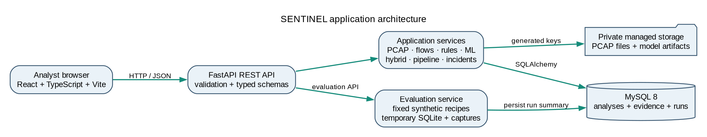

### 3.4 Frontend route structure

React Router 6.30.6 maps major screens to direct URLs. The shared shell contains branding, navigation, readiness state, breadcrumbs, and route content. Analysis pages retain their analysis ID; unknown paths show a not-found page. Analytics and evaluation components are lazy-loaded. The routes include `/`, `/upload`, `/analyses`, `/analyses/:analysisId`, the analysis packet/flow/rules/ML/hybrid/pipeline/analytics subroutes, `/events`, `/events/:eventId`, `/incidents`, `/incidents/:incidentId`, `/compare`, `/evaluation`, and `/evaluation/:evaluationId`.

### 3.5 API organization

FastAPI routers are grouped by responsibility: health, dashboard, analytics, events, evaluations, incidents, analyses and uploads, flows, detections, hybrid assessments, pipeline, and ML. OpenAPI documentation is served by FastAPI. Endpoints preserve independently callable processing stages; the pipeline is an additional orchestration API, not a replacement for those stage endpoints.

## Chapter 4 — Architecture and Database Design

### 4.1 Analysis and evidence relationships

An analysis owns packet metadata and generated flows. Detection runs belong to an analysis and own findings; findings may reference supporting flows through a junction table. Inference results reference a model version, analysis, and flow. A hybrid assessment records the selected detection run and model version, with child risk groups and source evidence. Incidents reference selected detection findings, ML results, or hybrid assessments through typed evidence relationships and retain notes and history as separate records. Pipeline runs own ordered stage executions. Evaluation runs are independent records and do not create operational analyses or incidents.

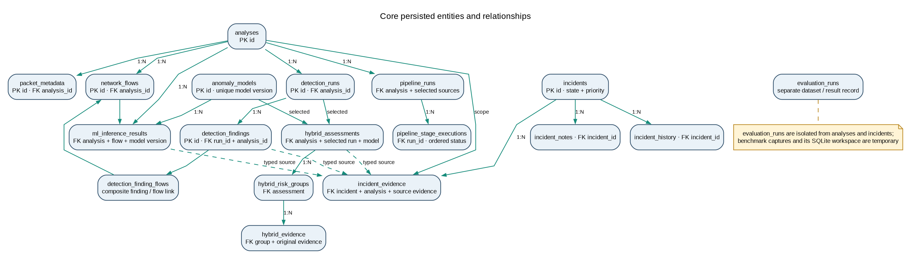

### 4.2 Migration history

Table 3. Database migration history.

| Revision | Purpose |
| --- | --- |
| `0001_create_analyses` | Initial analysis table |
| `0002_capture_metadata` | Capture metadata and packet records |
| `0003_bidirectional_flows` | Flow storage, packet assignments, generation state |
| `0004_rule_based_detection` | Directional TCP counts, runs, findings, supporting flows |
| `0005_isolation_forest` | Model metadata and inference results |
| `0006_hybrid_assessments` | Assessments, risk groups, source evidence |
| `0007_pipeline_runs` | Pipeline run and stage state |
| `0008_incident_investigation` | Incidents, evidence links, notes, history |
| `0009_evaluation_runs` | Persisted evaluation run metadata and JSON result |

The existing MySQL database was verified at `0009_evaluation_runs` with no Alembic schema drift at Day 12. Day 13 does not modify the database schema.

### 4.3 Capture and model storage

Capture uploads are streamed into application-managed storage using temporary names; final names are generated by the server. Capture storage is private and not publicly routed. Model artifacts use generated keys under managed model storage, and the application accepts no user-supplied joblib/pickle model uploads. Filesystem permissions are restricted where supported by the host platform.

### 4.4 Core entity summary

The main records are:

- `analyses`, `packet_metadata`, and `network_flows` for capture state and derived traffic metadata.
- `detection_runs` and `detection_findings` for rule output.
- `anomaly_models` and `ml_inference_results` for model versions and predictions.
- `hybrid_assessments`, `hybrid_risk_groups`, and `hybrid_evidence` for scored evidence.
- `pipeline_runs` and `pipeline_stage_executions` for orchestration state.
- `incidents`, `incident_evidence`, `incident_notes`, and `incident_history` for analyst investigations.
- `evaluation_runs` for reproducible synthetic benchmark results.

## Chapter 5 — Implementation

### 5.1 Foundation and PCAP ingestion

The foundation configured FastAPI, SQLAlchemy, Alembic, MySQL Compose settings, React/Vite, and health/readiness APIs. Ingestion uses streamed multipart handling and structural validation. Server-generated storage keys are separate from the display filename. Packet metadata is persisted without payload bytes. Parsing and storage are synchronous, and malformed captures produce safe client-facing errors.

### 5.2 Flow aggregation

Flow generation reads persisted packet metadata in batches and creates canonical bidirectional flow IDs scoped to an analysis. It records forward and backward counts, aggregate packet sizes, time statistics, TCP flags, and rates when the input supports them. A repeated completed request reuses the generated flows rather than duplicating them.

### 5.3 Rule-based detection

Three configurable rule categories are implemented: multi-port probing by directed source/target pair, capture-wide SYN-only volume, and distinct TCP flow tuples with SYN-only traffic. Default Low/Medium/High/Critical thresholds are 5/10/25/50 ports, 20/100/500/1,000 SYN-only packets, and 10/25/50/100 qualifying TCP tuples. SYN totals cover the full capture; the implementation does not invent a time window because per-packet flag timestamps are not retained in the aggregate. Runs store configuration snapshots and hashes. Findings retain explanations and bounded supporting-flow samples.

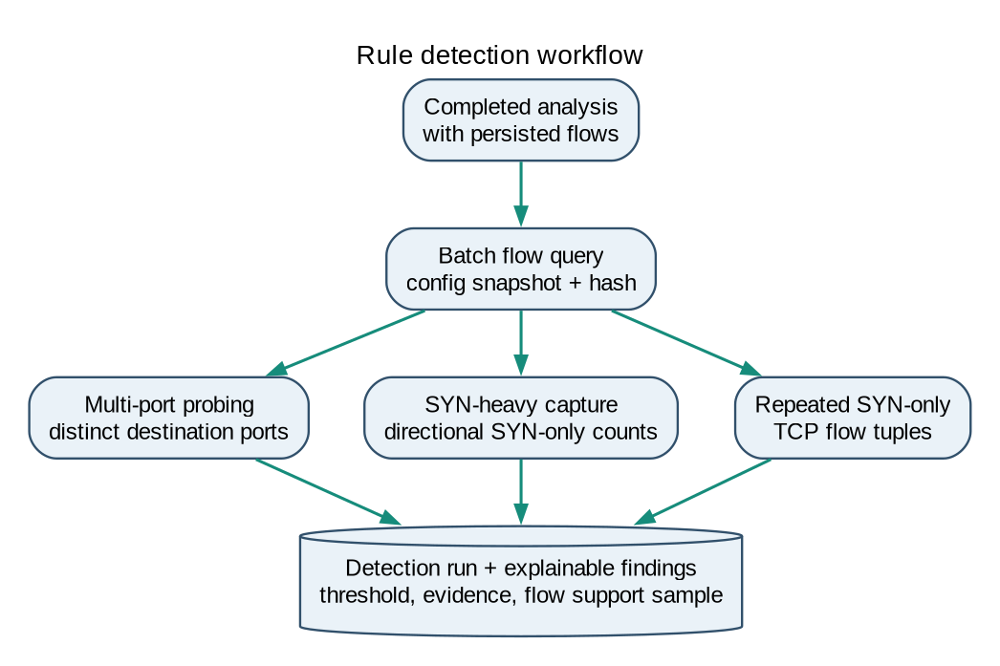

### 5.4 Machine-learning training and inference

The `flow-v1` schema contains 23 numeric flow fields: duration; total and directional packet/byte counts; packet-length minimum, maximum, mean, and standard deviation; inter-arrival minimum, maximum, mean, and standard deviation; six TCP flag counts; and packet/byte rates. Preprocessing uses training-set medians plus missingness indicators, applies `log1p` to nonnegative values, and removes constant transformed dimensions. Identifiers, endpoint fields, timestamps, and labels are excluded.

Table 4. `flow-v1` numeric feature families.

| Feature family | Fields or meaning |
| --- | --- |
| Duration and volume | Duration, total packets, total bytes |
| Directional volume | Forward/backward packets and bytes |
| Packet length | Minimum, maximum, mean, population standard deviation |
| Inter-arrival timing | Minimum, maximum, mean, population standard deviation |
| TCP control flags | SYN, ACK, FIN, RST, PSH, URG counts |
| Rates | Packets per second and bytes per second when duration is valid |

The product training endpoint requires the analyst to select completed analyses with generated flows and at least 20 records. Its default model configuration is 200 estimators, `contamination="auto"`, `max_samples="auto"`, and random seed 42. New training creates a new version. Inference requires explicit model selection, checks schema and scikit-learn compatibility, and stores a prediction and `-decision_function` score per flow. Score labels are anomaly indicators, not probabilities.

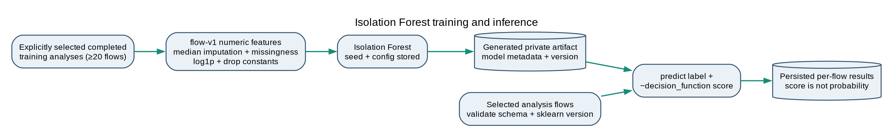

### 5.5 Hybrid assessment

Hybrid execution requires a completed selected rule run and complete inference results from the explicitly selected model for that analysis. It does not launch the source stages. It groups evidence analysis-locally by canonical endpoint IP pair and protocol; missing endpoints remain isolated. Exact shared-flow evidence receives a configured bonus; endpoint-only overlap does not. All source IDs and versions are persisted for traceability.

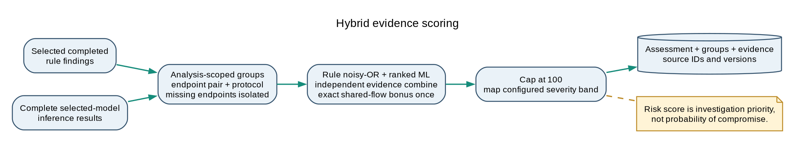

### 5.6 Pipeline orchestration

The pipeline calls existing flow, rule, ML, and hybrid services in that order. Requests explicitly name stages and required run/model selections. It validates prerequisites, reuses existing valid results, records ordered stage status and safe error summaries, and does not train models. Successful earlier stage persistence remains when a later stage fails. Execution is synchronous; pipeline run state and stage rows provide recovery and history.

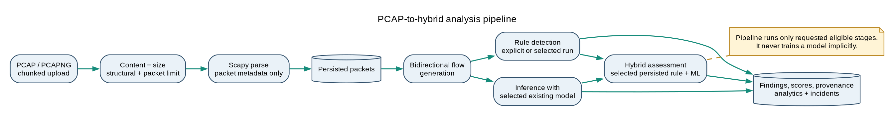

### 5.7 Dashboard, traffic analytics, and events

The overview uses persisted all-time aggregates and latest applicable runs to avoid summing unrelated historical reruns. Traffic analytics are scoped to one selected capture and use packet timestamps where available. Protocol charts, flow statistics, and timeline buckets are not live monitoring. The event feed distinguishes rule findings, ML anomaly indicators, and hybrid assessments. Event timestamps represent the source record timestamp and are labelled accordingly.

### 5.8 Incident investigation

An analyst explicitly creates an incident from selected persisted evidence. Incident fields, status, priority, related analysis, notes, and investigation history are persisted separately from the underlying detection results. Evidence attachments validate their source relationships and reject duplicate associations. The product has no authenticated actor, so actor fields remain null rather than using a fabricated account identity. Incidents are investigations, not automatic declarations of confirmed attacks.

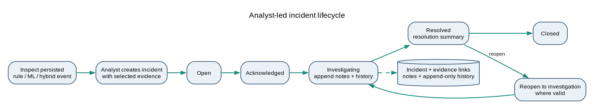

### 5.9 Evaluation framework

The evaluation service generates fixed Scapy packet recipes with a deterministic seed. It trains on a benign-only partition, then evaluates rule-only, ML-only, and hybrid configurations on the same disjoint test captures. Each engine output is scored against labels assigned from recipe parameters before detection. Run metadata and structured results are persisted separately from operational analyses and incidents. The evaluation run shown in this report is the currently persisted completed run #1.

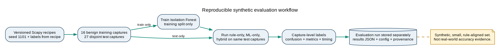

## Chapter 6 — Detection Methodology

### 6.1 Rule decisions

For each rule category, the configured threshold ladder maps the observed indicator count to a severity threshold. A capture-level rule-only evaluation is positive if at least one finding exists in the selected completed run. The binary evaluation definition does not change the production finding semantics or imply that the capture is malicious.

### 6.2 Isolation Forest preprocessing and model settings

The product feature transformer learns medians and active dimensions on the explicitly selected training set. Missing values are replaced with the training median and represented by indicators; skewed nonnegative features are compressed with `log1p`; dimensions that become constant are removed. The benchmark model is a separately recorded evaluation configuration: 100 estimators, contamination 0.1, `max_samples="auto"`, seed 1101, and `flow-v1`. It must not be confused with the product training endpoint defaults.

For this evaluation, ML-only capture prediction is positive if one or more flows receive scikit-learn's anomaly label. The benchmark also applies fixed score thresholds `>0.00`, `>0.05`, and `>0.10` without retraining or selecting thresholds from test labels. Raw anomaly scores are model-relative values, not probability estimates.

### 6.3 Hybrid risk scoring

The hybrid engine uses configured rule weights: Low 10, Medium 25, High 45, and Critical 65. Duplicate findings with the same rule ID use the highest weight; distinct rule contributions combine using noisy-OR:

`R = 100 × (1 − ∏(1 − wᵢ / 100))`

Anomaly scores are converted to within-analysis/model percent ranks, then mapped to `M = 20 + 30 × rank`. The maximum ML contribution per group is used. Rule and ML values combine as:

`C = 100 × (1 − (1 − R / 100)(1 − M / 100))`

One configured 15-point exact-flow corroboration bonus may be added, after which the group score is capped at 100. The assessment score is the maximum group score. Configured severity bands are Informational 0, Low 1–24, Medium 25–49, High 50–74, and Critical 75–100. These values prioritize investigation and are not probabilities of compromise.

### 6.4 Explainability and provenance

Rule results retain rule ID, severity, explanation, evidence, threshold/configuration snapshot, and support-flow links. ML results retain model ID/version, flow ID, label, and score. Hybrid evidence links to the originating finding or anomaly result and records the selected source versions. Analysts can navigate from an event or incident evidence to the original analysis and flow/finding where those relationships exist.

## Chapter 7 — Experimental Evaluation

### 7.1 Dataset and protocol

The persisted run uses `sentinel-synthetic-flow-v1`, generator seed 1101, evaluation random seed 1101, and three repeats. The 16 benign training captures are disjoint from 27 test captures: 15 benign and 12 suspicious. The test recipes include normal TCP, UDP, ICMP, incomplete metadata, benign four-port bursts, port scanning, SYN-heavy activity, and repeated SYN tuples. Each capture has a stable sample ID in the manifest. Ground truth is assigned from the deterministic recipe before the detection engines run; it is not inferred from a rule, ML label, or hybrid score. No public dataset is used.

The detection evaluation unit is a capture. Rule-only is positive when the configured run has one or more findings. ML-only is positive when at least one flow has an anomaly label. Hybrid is positive when its persisted risk score is greater than zero; this is an evaluation threshold, not a probability claim. Confusion matrices use `[[TN, FP], [FN, TP]]`.

Precision is `TP / (TP + FP)`, recall is `TP / (TP + FN)`, F1 is `2 × precision × recall / (precision + recall)`, and false-positive rate is `FP / (FP + TN)`. A metric with a zero denominator is undefined and remains null rather than being replaced by zero.

### 7.2 Detection results

The following values were read from the persisted evaluation run #1 in MySQL and are also summarized in `docs/evaluation/results/run-1-summary.json`.

Table 5. Capture-level results for the persisted synthetic evaluation.

| Configuration | TP | FP | TN | FN | Precision | Recall | F1 | FPR | Confusion matrix |
| --- | ---: | ---: | ---: | ---: | ---: | ---: | ---: | ---: | --- |
| Rule only | 12 | 0 | 15 | 0 | 1.000 | 1.000 | 1.000 | 0.000 | `[[15, 0], [0, 12]]` |
| ML only | 12 | 4 | 11 | 0 | 0.750 | 1.000 | 0.857 | 0.267 | `[[11, 4], [0, 12]]` |
| Hybrid | 12 | 4 | 11 | 0 | 0.750 | 1.000 | 0.857 | 0.267 | `[[11, 4], [0, 12]]` |

The configured-rule result is perfect only against this small recipe set, whose suspicious patterns deliberately match existing rule logic. Four rule categories' positive test cases are explicitly constructed to cross a configured threshold. The result is not an estimate of general detection performance.

The four ML and hybrid false positives were `test-normal_icmp-01`, `test-normal_icmp-02`, and the two incomplete-metadata captures. Each is unusual relative to the 16 benign training captures and was flagged by the model; the hybrid engine faithfully preserved that evidence and therefore did not improve the capture-level result on this benchmark. No false-negative cases occurred under the baseline configuration.

### 7.3 Rule category and threshold analysis

Table 6. Rule-category results for configured and doubled thresholds.

| Rule category | Configured TP / FP / TN / FN | Configured recall | Doubled-threshold TP / FP / TN / FN | Doubled-threshold recall |
| --- | --- | ---: | --- | ---: |
| Multi-port probing | 8 / 0 / 19 / 0 | 1.000 | 4 / 0 / 19 / 4 | 0.500 |
| SYN-heavy activity | 4 / 0 / 23 / 0 | 1.000 | 0 / 0 / 23 / 4 | 0.000 |
| Repeated SYN tuples | 4 / 0 / 23 / 0 | 1.000 | 0 / 0 / 23 / 4 | 0.000 |

With doubled configured thresholds, the combined rule decision was TP 4, FP 0, TN 15, FN 8: `[[15, 0], [8, 4]]`, precision 1.000, recall 0.333, F1 0.500, and FPR 0.000. Repeated-SYN test captures still crossed the stricter multi-port rule; the category table evaluates the repeated-SYN rule itself. Under doubled thresholds, the SYN-heavy and repeated-SYN categories made no positive predictions, so their precision and F1 are undefined rather than zero or perfect.

### 7.4 ML score sweep and hybrid outputs

Table 7. ML metrics at fixed anomaly-score thresholds.

| Fixed anomaly-score threshold | TP | FP | TN | FN | Precision | Recall | F1 | FPR |
| --- | ---: | ---: | ---: | ---: | ---: | ---: | ---: | ---: |
| `> 0.00` | 12 | 4 | 11 | 0 | 0.750 | 1.000 | 0.857 | 0.267 |
| `> 0.05` | 8 | 4 | 11 | 4 | 0.667 | 0.667 | 0.667 | 0.267 |
| `> 0.10` | 0 | 2 | 13 | 12 | 0.000 | 0.000 | 0.000 | 0.133 |

The hybrid-risk distribution ranged from 0 to 61, with median 20 and P90 61. Severity counts were 11 Informational, 4 Low, 8 Medium, 4 High, and 0 Critical. The positive-risk threshold used for evaluation means every non-zero assessment is counted as a positive capture; this does not make the score an attack probability.

### 7.5 Performance measurements

The benchmark executed three repeated passes over 27 test captures, yielding 81 per-capture observations. Each pass covered 306 test packets and 128 flows over 19,400 total capture bytes. The engine benchmark used temporary captures and an isolated in-memory SQLite workspace; production MySQL persistence time was excluded. Capture generation and model fitting are reported separately from end-to-end stage time.

Table 8. Processing times and throughput measured in the synthetic benchmark.

| Stage or measure | Median | Mean / value | Observations / unit |
| --- | ---: | ---: | --- |
| Packet parse and metadata | 1.946 ms | 2.085 ms | 81 captures |
| Flow generation | 5.316 ms | 5.572 ms | 81 captures |
| Rule detection | 2.106 ms | 2.312 ms | 81 captures |
| ML inference | 19.293 ms | 20.275 ms | 81 captures |
| Hybrid assessment | 8.347 ms | 8.345 ms | 81 captures |
| End-to-end pipeline | 47.646 ms | 47.651 ms | 81 captures |
| Isolation Forest model fit | 120.633 ms | 125.507 ms | 3 fits |
| End-to-end throughput | — | 237.84 packets/s | aggregate test pass |
| Flow throughput | — | 99.49 flows/s | aggregate test pass |

The recorded environment was Linux x86_64, Python 3.12.16, scikit-learn 1.9.1, and four logical CPUs; the processor model was not reported. Process high-water RSS was 212,660,224 bytes before the evaluation and 223,637,504 bytes after it. These are process-level maximum resident-set measurements, not memory attributable solely to the evaluation. They do not establish the memory requirement for larger captures.

## Chapter 8 — Security and Quality Assurance

### 8.1 Implemented controls

Day 12 added a configurable packet-count limit defaulting to 100,000 and capped at 1,000,000, in addition to the default 100 MiB upload limit. Upload storage directories are changed to mode `0700` on POSIX; temporary files are created with restrictive permissions. State-changing browser requests with an `Origin` other than the configured frontend origin are rejected. Incident titles are normalized and whitespace-only values rejected. Analytics and evaluation routes are lazy-loaded, reducing the initial JavaScript chunk from 706.93 kB to 257.09 kB in the recorded build; the largest chart chunk was 396.04 kB.

The code has no model-upload endpoint. Inference loads only application-generated joblib artifacts referenced by managed model records and checks schema and scikit-learn version compatibility. This reduces exposure but does not make joblib safe if the managed artifact directory or database is writable by an attacker.

### 8.2 Verification

The Day 12 full backend suite passed 142 tests; the frontend suite passed 55 tests. Ruff check and formatting, ESLint, Prettier, TypeScript compilation, frontend production build, Docker Compose configuration validation, and DOCX archive/content validation passed. Alembic verified MySQL at `0009_evaluation_runs` with no schema drift, and disposable SQLite migration tests upgraded through the same revision. `pip-audit --local` reported no known backend vulnerabilities. `npm audit` reported two moderate advisories affecting React Router 6.30.6; the available remediation requires a major React Router 7 upgrade and was not applied in the focused hardening milestone.

Headless Chromium captures were visually reviewed after API-backed content loaded for the overview, upload, analysis detail, traffic analytics, security-event feed, incident overview, and evaluation history. The pages are screenshots of the application and contain synthetic demonstration records where marked; they are not screenshots of real network activity. Docker Compose configuration was checked, but Docker runtime inspection was unavailable because Docker socket access was denied.

### 8.3 Remaining security and operational risks

Table 9. Security and quality findings with their current disposition.

| Severity | Finding | Current disposition |
| --- | --- | --- |
| Medium, fixed | A small capture could contain many tiny packet records and cause excessive downstream work. | Configurable packet-count cap; PCAP and PCAPNG over-limit tests. |
| Medium, fixed | Existing capture directories could have permissive permissions. | Upload staging sets POSIX directory mode to `0700`; file and directory mode tests pass. |
| Medium, fixed | CORS alone does not reject simple cross-origin form writes. | State-changing requests with a mismatched `Origin` are rejected; absent `Origin` is still permitted. |
| Low, fixed | A whitespace-only incident title could normalize to an empty string. | Schema validators trim and reject blank titles. |
| High, unresolved by design | The API has no authentication, authorization, or per-user ownership. | Keep the application on a trusted local interface; this is not a multi-user service. |
| Medium, operational | Processing is synchronous and captures are retained without automatic cleanup. | Request and data bounds exist; monitor storage and do not expose the API publicly. |
| Medium, dependency | Two moderate npm advisories affect React Router 6.30.6. | Retained for this release; available fix requires React Router 7 migration and further compatibility tests. |
| Informational, residual | Joblib can execute code if an attacker can replace a trusted artifact. | No model upload endpoint; managed storage and database must remain trusted. |

SENTINEL has no authentication or per-user authorization. The Origin check does not authenticate a caller and requests without an Origin header remain supported for local clients. The system is a local single-user tool and must not be exposed to an untrusted network. Upload parsing, flow generation, detection, inference, hybrid assessment, evaluation, and pipeline requests run synchronously. There is no background worker, automatic capture retention, or operation timeout. Storage use must be monitored. No production security certification is claimed.

## Chapter 9 — Results and Discussion

The test set contains only 27 generated captures and is not representative of the diversity, volume, timing, encryption, and host behavior found in real networks. Labels are assigned at capture level and do not identify every malicious or benign flow within a capture. Rule recipes were intentionally written to trigger the current rule conditions, so the rule-only result demonstrates implementation behavior on those defined cases rather than independent generalization. The benign port-burst pattern tests a nearby benign case but does not represent a broad false-positive population.

ML produced four false positives because benign ICMP and incomplete-metadata flows differed from the small benign training partition. This illustrates a central limitation of unsupervised anomaly detection: statistical unusualness is not equivalent to maliciousness. Hybrid matched ML-only because rule contributions did not remove those ML-only risk groups, and the capture-level hybrid test treats any positive risk score as a positive decision. It did not outperform ML in this experiment.

The measured pipeline median was 47.646 ms per small generated test capture in the described local environment. Inference was the largest listed median stage (19.293 ms), followed by hybrid assessment (8.347 ms) and flow generation (5.316 ms). These times exclude model fitting, capture creation, and MySQL persistence. They should not be extrapolated to large captures or different machines. Synchronous processing and retained captures remain operational constraints.

No public labelled dataset, independently sourced real traffic, production network, or cross-machine comparison was used. The current results cannot establish real-world detection accuracy, generalization, security efficacy, or production readiness. The results are useful for repeatability, feature-flow verification, and demonstrating the tradeoffs exposed by this particular synthetic set.

## Chapter 10 — Conclusion and Future Work

SENTINEL integrates offline capture ingestion, metadata extraction, bidirectional flow generation, configurable rules, versioned Isolation Forest inference, hybrid evidence scoring, pipeline orchestration, browser analytics, persisted security events, analyst-managed incidents, and a reproducible synthetic evaluation. Its data model preserves analysis and detection provenance, while its interfaces distinguish findings, events, and incidents. The benchmark documents both successful synthetic detections and benign cases flagged as anomalous.

The prototype remains limited by synthetic-only evaluation, capture-level labels, uncalibrated anomaly and risk scores, synchronous operations, no authentication, no automatic retention, and the known React Router dependency advisories. The next research and engineering work should prioritize independently sourced public labelled datasets, authorized real-world evaluation, score calibration based on an appropriate validation design, and a separately scoped authentication/authorization architecture. Asynchronous processing, retention controls, broader protocols and capture behavior, and optional live capture can be considered after the offline core is evaluated. None of these future items is implemented in this report.

## References

[1] F. T. Liu, K. M. Ting, and Z.-H. Zhou, “Isolation Forest,” in *Proceedings of the 2008 Eighth IEEE International Conference on Data Mining*, Pisa, Italy, 2008, pp. 413–422, doi: 10.1109/ICDM.2008.17.

[2] W. Lee and S. J. Stolfo, “A Framework for Constructing Features and Models for Intrusion Detection Systems,” *ACM Transactions on Information and System Security*, vol. 3, no. 4, pp. 227–261, 2000, doi: 10.1145/382912.382914.

[3] J. McHugh, “Testing Intrusion Detection Systems: A Critique of the 1998 and 1999 DARPA Intrusion Detection System Evaluations as Performed by Lincoln Laboratory,” *ACM Transactions on Information and System Security*, vol. 3, no. 4, pp. 262–294, 2000, doi: 10.1145/382912.382923.

[4] Scapy Project, “Usage: Reading and Writing Packets,” *Scapy Documentation*. [Online]. Available: <https://scapy.readthedocs.io/en/latest/usage.html>.

[5] FastAPI, “Request Files,” *FastAPI Documentation*. [Online]. Available: <https://fastapi.tiangolo.com/tutorial/request-files/>.

[6] Meta Open Source, “Quick Start,” *React Documentation*. [Online]. Available: <https://react.dev/learn>.

[7] Oracle Corporation, *MySQL 8.0 Reference Manual*. [Online]. Available: <https://dev.mysql.com/doc/refman/8.0/en/>.

[8] Docker, “Docker Compose,” *Docker Documentation*. [Online]. Available: <https://docs.docker.com/compose/>.

[9] `draft-ietf-opsawg-pcapng`, Internet-Draft on the PCAPNG capture file format. [Online]. Available: <https://datatracker.ietf.org/doc/draft-ietf-opsawg-pcapng/>.

[10] scikit-learn developers, “IsolationForest,” *scikit-learn API Reference*. [Online]. Available: <https://scikit-learn.org/stable/modules/generated/sklearn.ensemble.IsolationForest.html>.

The three DOI records in [1]–[3] were checked through Crossref. Software documentation references [4]–[10] identify official project documentation used to describe the implemented libraries and format. The PCAPNG Internet-Draft is cited as a draft, not as a finalized RFC.

## Appendix A — Application startup and verification

The README provides current setup instructions and the `.env.example` lists local development settings. The standard local URLs are `http://localhost:5174` for the frontend, `http://localhost:8001` for the API, and `http://localhost:8001/docs` for OpenAPI. MySQL is exposed to the host on `127.0.0.1:3307` by the Compose configuration.

Representative verification commands are:

```sh
docker compose up -d db
uv run --project backend alembic -c backend/alembic.ini upgrade head
uv run --project backend pytest backend/tests
uv run --project backend ruff check backend
uv run --project backend ruff format --check backend
cd frontend && npm test -- --run && npm run lint && npm run format:check && npm run build
```

The report's Day 12 verification counts are a recorded milestone result. Re-run the commands in the target submission environment before claiming a fresh final verification.

## Appendix B — Selected API groups

Table 10. Selected API groups.

| Capability | API prefix or endpoint |
| --- | --- |
| Health/readiness | `/health`, `/health/ready` |
| Dashboard | `/api/v1/dashboard` |
| Upload and analysis | `/api/v1/analyses` |
| Traffic analytics | `/api/v1/analytics` |
| Security events | `/api/v1/events` |
| Incidents | `/api/v1/incidents` |
| Model training and inference | `/api/v1/ml` and analysis-scoped ML routes |
| Hybrid assessment | `/api/v1/analyses/{analysis_id}/hybrid` |
| Pipeline | `/api/v1/analyses/{analysis_id}/pipeline` |
| Evaluation | `/api/v1/evaluations` |

## Appendix C — Genuine application screenshots

The following figures are captured from the running SENTINEL browser application. Screenshots show persisted synthetic demo data where the capture is named `SYNTHETIC-target.pcap` or the incident description identifies a demonstration. IP addresses in the synthetic target use documentation ranges. No screenshot represents real-world network traffic.

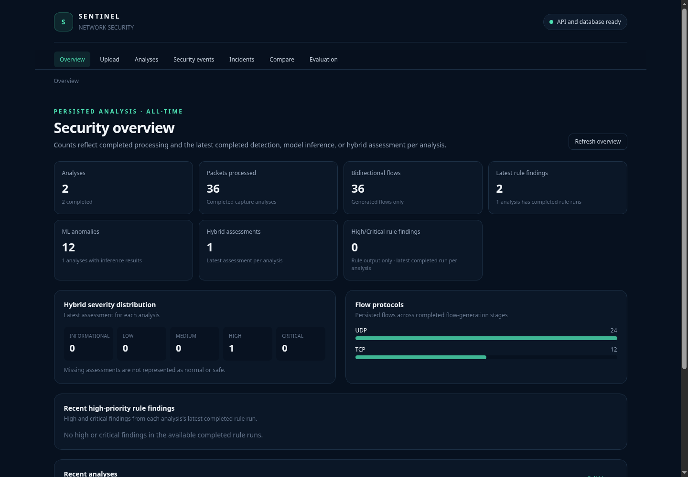

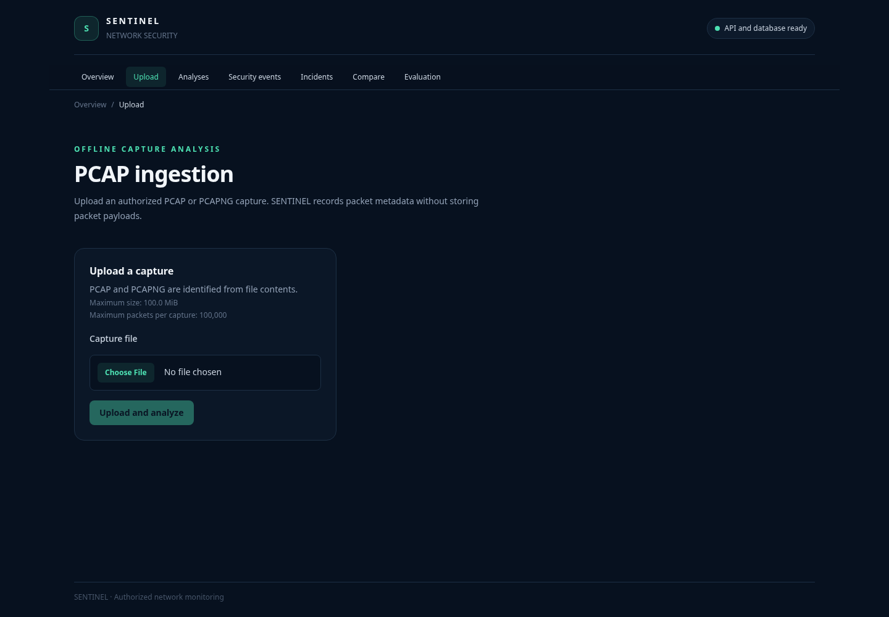

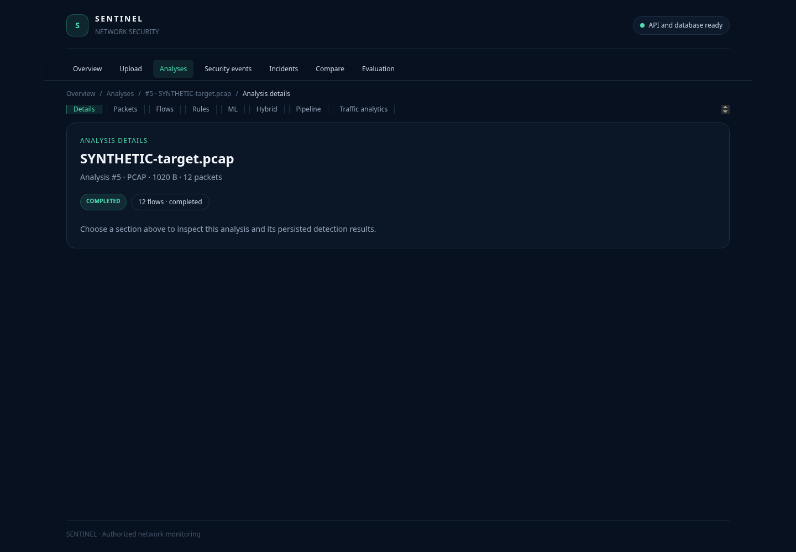

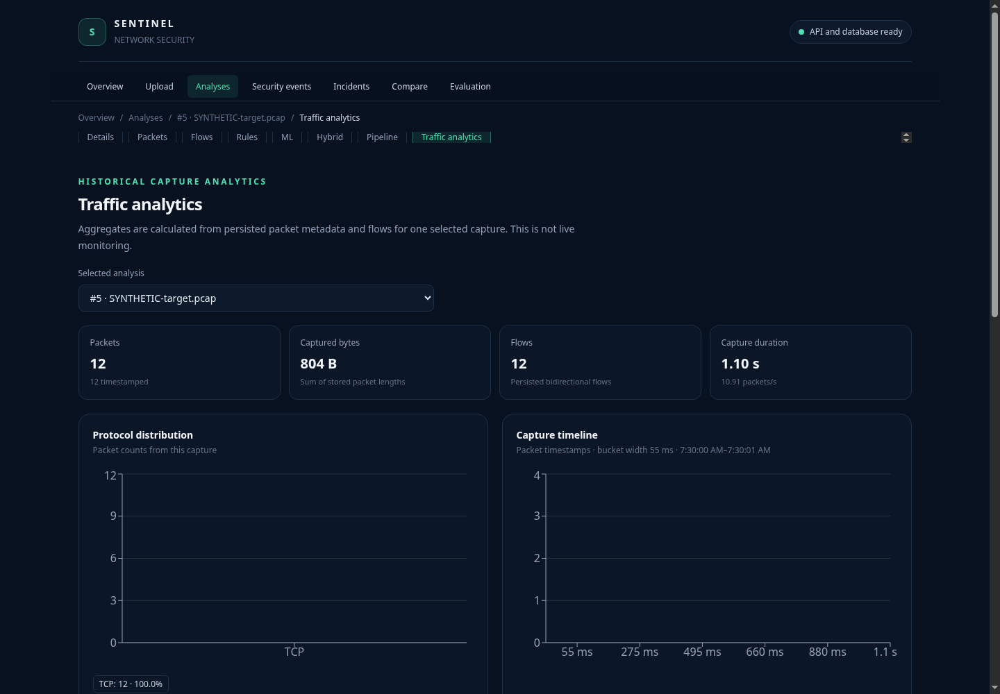

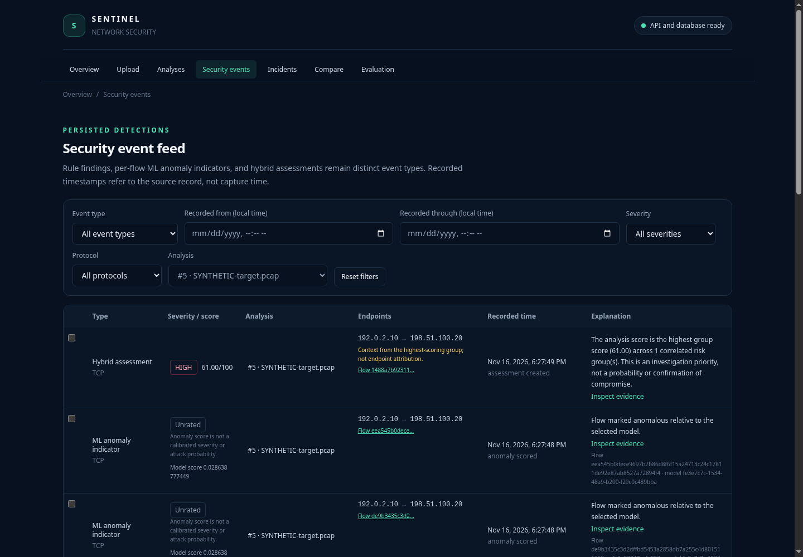

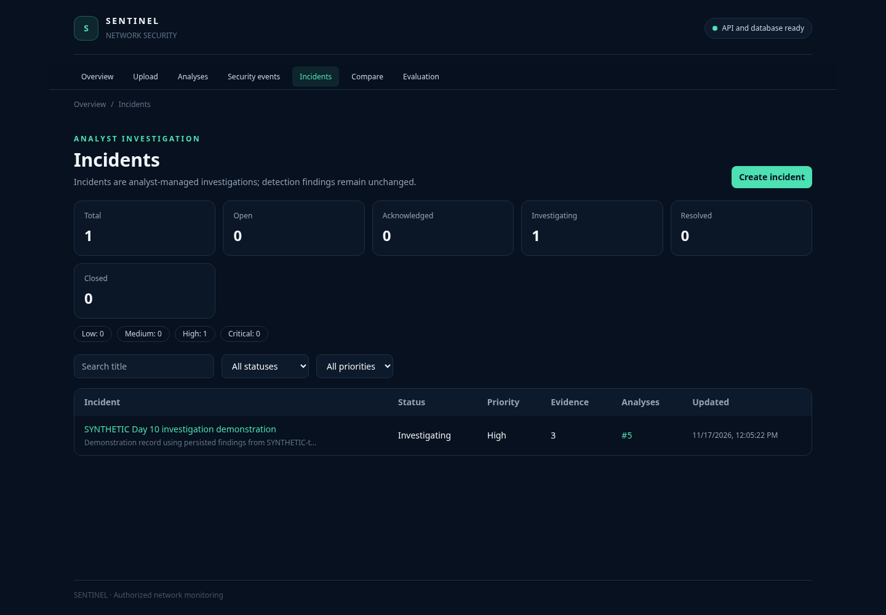

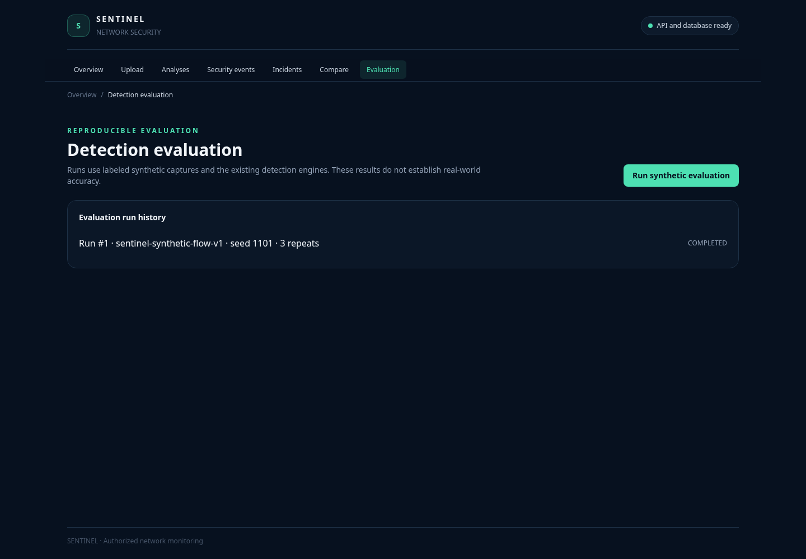
